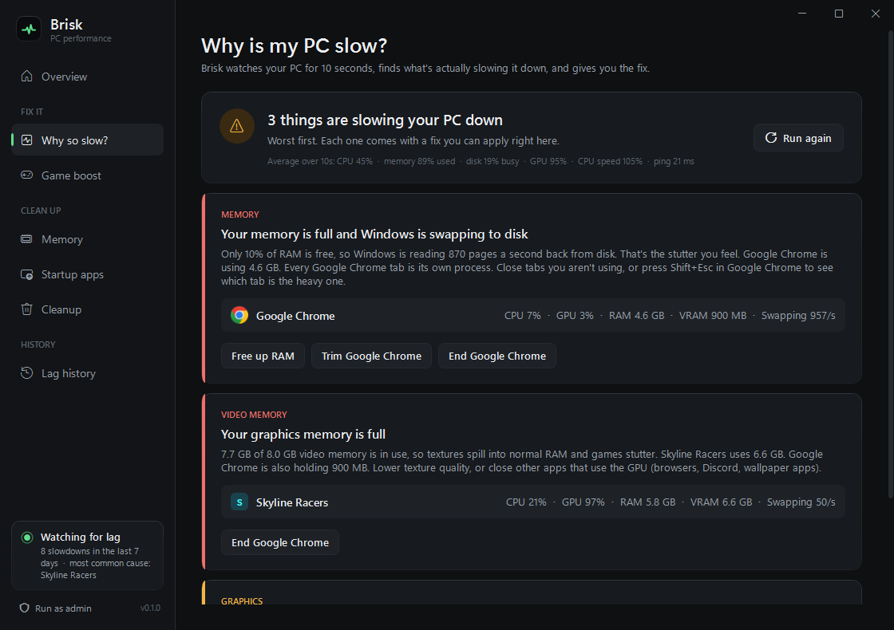
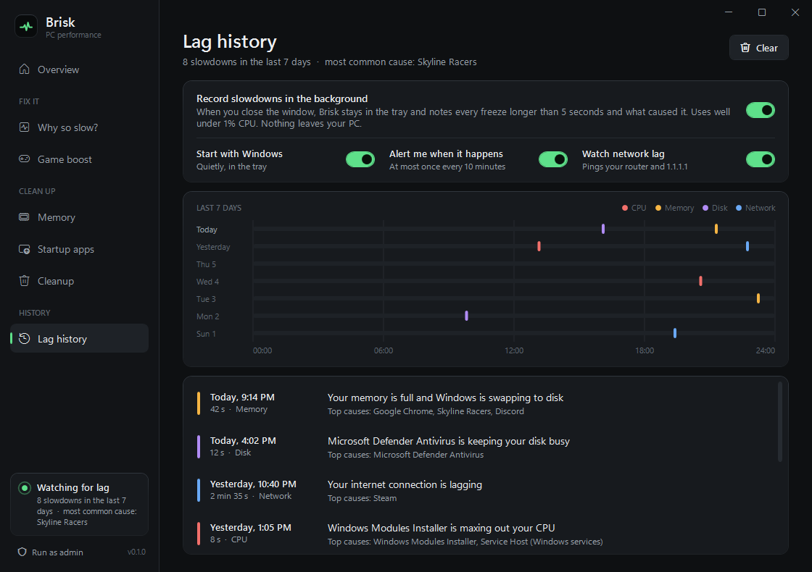
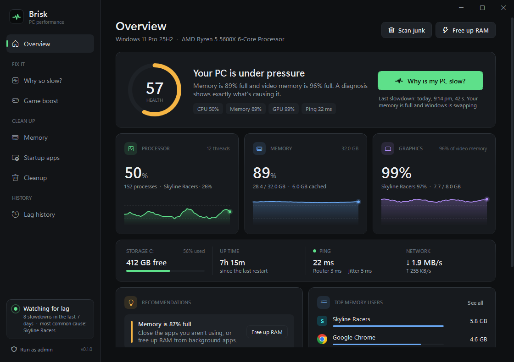
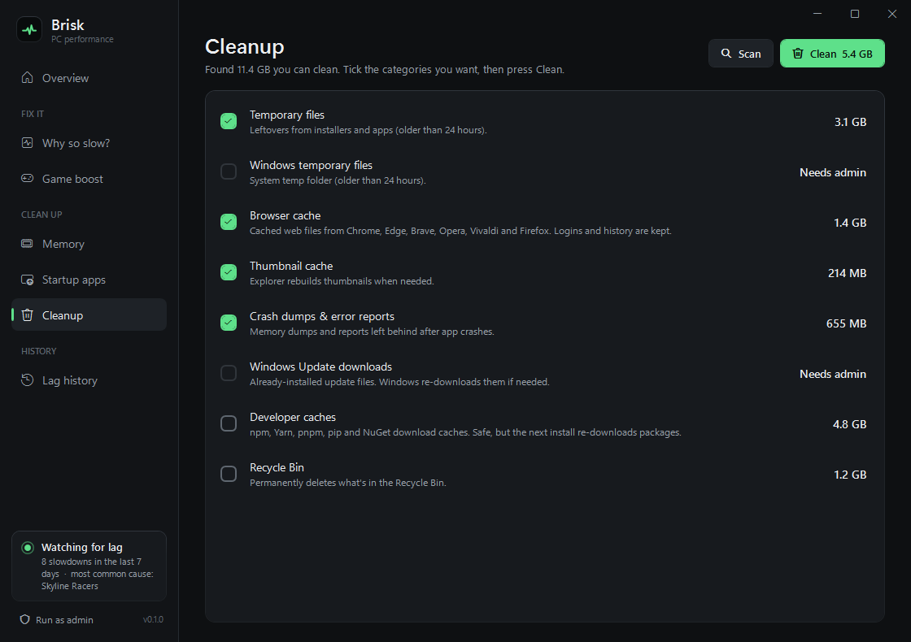
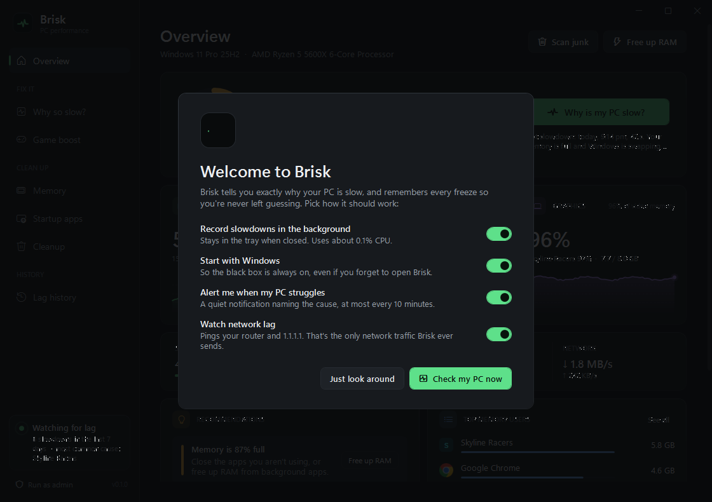

<p align="center">
  
</p>

<h1 align="center">Brisk</h1>

<p align="center">
  <b>Your PC is slow. Brisk tells you why.</b><br/>
  One button names the exact app or Windows task slowing you down, in plain English, with a one-click fix.<br/>
  A lag black box in the tray remembers every freeze, so you know what happened instead of guessing.
</p>

<p align="center">
  <a href="https://github.com/ohhamzaa/brisk/actions/workflows/build.yml"></a>
  <a href="https://github.com/ohhamzaa/brisk/releases/latest"></a>
  
  
  <a href="LICENSE"></a>
</p>

<p align="center">
  <a href="https://github.com/ohhamzaa/brisk/releases/latest"><b>⬇ Download for Windows</b></a>  ·  free, open source, no ads, no account
</p>

<p align="center">
  
</p>

---

## What makes it different

### 1. "Why is my PC slow?" diagnosis
Press **Diagnose now** while your PC feels slow. Brisk watches for 10 seconds and gives you an **answer**, not a wall of graphs:

> **Google Chrome is making Windows swap to disk.** Only 6% of RAM is free, so Windows is reading 2,400 pages a second back from disk. That's the stutter you feel. Chrome is using 6.1 GB. *[Free up RAM] [Trim Chrome] [End Chrome]*

> **Microsoft Defender is keeping your disk busy.** It's scanning your files and finishes on its own. You can schedule scans for when you're away in Windows Security.

> **Your CPU is running at only 48% of its normal speed.** Power saver mode is holding it back. *[Switch to High performance]*

> **Your Wi-Fi / router connection is unstable.** Pings to your own router take 85 ms and 20% are lost. On a healthy home network that's under 10 ms. Move closer, switch to 5 GHz or Ethernet, or restart the router.

> **Your graphics memory is full.** 7.8 GB of 8 GB video memory is in use, so textures spill into normal RAM and games stutter. Chrome is also holding 1 GB. *[End Chrome]*

What it checks:
- **CPU** load and who's causing it, plus **CPU speed throttling** from power plans, battery or heat
- **Memory** pressure and **which app is making Windows swap** (per-app hard faults, not just "the biggest app")
- **Disk** activity per app, and low disk space
- **Graphics**: GPU load and **video memory** per app, read from the same counters Task Manager uses
- **Network**: ping to your **router** *and* to the internet, so it can tell "your Wi-Fi is the problem" apart from "your provider is", plus packet loss, jitter, and who's hogging the line

It recognizes Windows Update, Defender scans, Search indexing, OneDrive/Dropbox sync, game launchers and browsers, and explains each in a sentence.

### 2. Lag black box, with live alerts
Close the window and Brisk keeps watching from the tray, at **about 0.1% CPU**. Every freeze or lag spike longer than 5 seconds is logged with its cause, shown on a **7-day timeline**, and, if you want, **announced right away** with a notification ("Your PC struggled for 30 s. Chrome was maxing out your CPU.").

<p align="center">
  
</p>

"Why did my game stutter at 9 last night?" Now you can check. Turn on **Start with Windows** and it's always recording. Everything stays on your PC.

### 3. Game boost
Pick your game and press **Boost**. Brisk puts background apps into Windows **Efficiency mode** at lower priority, gives your game higher priority, frees idle memory, and switches to your fastest power plan. **Nothing is closed.** When the game exits, everything goes back exactly as it was. The state is saved to disk first, so even if Brisk crashes mid-game, the next launch restores it. Voice chat, overlays and Windows itself are never throttled.

## Plus the essentials, done honestly

| | |
|---|---|
| **Overview** | Live CPU, memory and storage with history graphs, your busiest apps, plain-English recommendations, and one-click power plan switching. |
| **Memory** | Every app grouped into one row (40 `chrome.exe` processes become one "Google Chrome" row) with real private memory and CPU. Trim or end any app. Core Windows processes are protected. |
| **Startup apps** | Everything that launches at sign-in, one switch each. Same settings Task Manager uses, so nothing is deleted and it's all reversible. |
| **Cleanup** | Temp files, browser caches (Chrome, Edge, Brave, Opera, Vivaldi, Firefox), thumbnails, crash dumps, Windows Update leftovers, dev caches (npm, pip, NuGet…), Recycle Bin. You pick what goes. |

<p align="center">
  
  
</p>

## Why trust it

Most "PC booster" apps are snake oil. They "free" RAM that Windows was deliberately using as cache, then show a big number so you feel good. Brisk doesn't:

- **Honest numbers.** Memory is shown as in use / available / cached, the way Windows itself counts it. Cached memory isn't wasted.
- **Safe cleaner.** Never follows symlinks or junctions, skips files in use, only touches temp files older than 24 hours, never goes near your documents. These rules are covered by automated tests, including a junction-escape test.
- **Light.** Native Windows app (C#/.NET, WPF). It reads all processes with one kernel call like Task Manager. Measured: **~0.1% CPU in the tray, ~0.6% with the window open** (12-thread Ryzen 5, RTX 3060). Animations pause when you can't see them.
- **Private.** No telemetry, no account, no analytics. The only network traffic is a ping to your router and to 1.1.1.1 every 2 seconds for lag detection, and you can switch that off.
- **Reversible.** Startup toggles, game boost and power plan changes can all be undone, and boost undoes itself.

## Install

1. Download `Brisk.exe` from the [latest release](https://github.com/ohhamzaa/brisk/releases/latest).
2. Run it. One portable file, nothing to install.

> Windows SmartScreen may warn about a new, unsigned app. Click **More info → Run anyway**. Every release is built by GitHub Actions straight from this repo.

Brisk runs without admin. A few things (Windows temp/update cleanup, all-user startup apps, clearing the standby cache) need admin: use **Restart as admin** in the sidebar.

On first launch a short welcome screen asks whether to record in the background, start with Windows, alert you, and watch network lag.

<p align="center">
  
</p>

Command line: `Brisk.exe --page diagnose` (or `boost`, `memory`, `startup`, `cleanup`, `history`) opens on a page; `--tray` starts hidden in the tray.

## Build from source

Requires the [.NET 10 SDK](https://dotnet.microsoft.com/download) on Windows.

```bash
git clone https://github.com/ohhamzaa/brisk.git
cd brisk
dotnet run --project src/Brisk
```

Portable single exe:

```bash
dotnet publish src/Brisk -c Release -r win-x64 -o dist
```

Tests (52 checks): cleanup sandbox (incl. junction escape), startup toggle round-trip, process scanner and I/O counters, every diagnosis rule (CPU, swap, disk, GPU, VRAM, Wi-Fi vs ISP), lag recorder, game boost on throwaway processes incl. crash recovery, GPU counters, power plan parsing:

```bash
dotnet run --project tests/Brisk.Tests
```

Per-part cost of one monitor tick: `dotnet run --project tests/Brisk.Tests -c Release -- --bench`

## How it works

| Area | Under the hood |
|---|---|
| Processes | `NtQuerySystemInformation(SystemProcessInformation)`: one call returns every process with private working set, CPU time, **hard-fault count** and **I/O bytes**. Diffing two snapshots gives per-app CPU %, swapping rate and disk throughput. |
| System counters | PDH: `PhysicalDisk % Idle Time`, `Processor Information % Processor Performance` (throttling), `Memory Pages Input/sec` (swapping), `Network Interface Bytes/sec`. |
| GPU | PDH `GPU Engine(*)\Utilization Percentage`, `GPU Process Memory(*)\Dedicated Usage`, `GPU Adapter Memory(*)`: per-process load (busiest engine, like Task Manager) and VRAM. |
| Network lag | ICMP ping every 2 s to the default gateway and 1.1.1.1; rolling 20 s average, loss and jitter. |
| Game boost | `SetPriorityClass` + `SetProcessInformation(ProcessPowerThrottling)` (EcoQoS / Efficiency mode), state persisted to `%LOCALAPPDATA%\Brisk\boost-state.json` and checked against process start times before restoring. |
| Diagnosis | `Diagnoser.Analyze()`: a pure function over 10 one-second samples, with rule thresholds plus a catalogue of known Windows tasks. The same code labels black-box events. |
| Black box | `LagRecorder`: a second counts as "hot" if CPU ≥ 90%, disk ≥ 90% busy, RAM ≤ 6% free or heavy swapping; 5+ hot seconds become an event. Saved to `%LOCALAPPDATA%\Brisk\lag-history.json`. |
| Free up RAM | `EmptyWorkingSet` on background processes; as admin, `NtSetSystemInformation(MemoryPurgeLowPriorityStandbyList)`. |
| Startup | `Run` keys + Startup folders, toggled via `Explorer\StartupApproved` (exactly what Task Manager writes). |

## Contributing

Issues and PRs welcome. Great first contributions:

- **Explanations for more apps** in [`AppNames.cs`](src/Brisk/Services/AppNames.cs) (game launchers, antivirus suites, backup tools…)
- More junk locations in [`JunkCleaner.cs`](src/Brisk/Services/JunkCleaner.cs)
- New diagnosis rules (GPU-bound, network-bound…) with a test in `tests/Brisk.Tests`
- Translations

Keep the spirit: **only add things that really make a PC faster or easier to understand, and never exaggerate results.**

## Project

- [Changelog](CHANGELOG.md)
- [Contributing guide](CONTRIBUTING.md)
- [Security policy](SECURITY.md)

## License

[MIT](LICENSE) © 2026 Hamza
